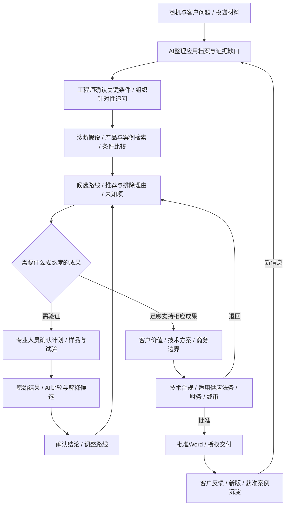
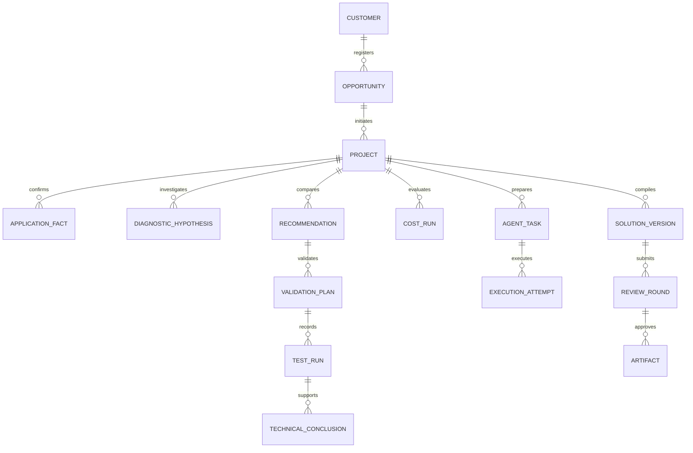
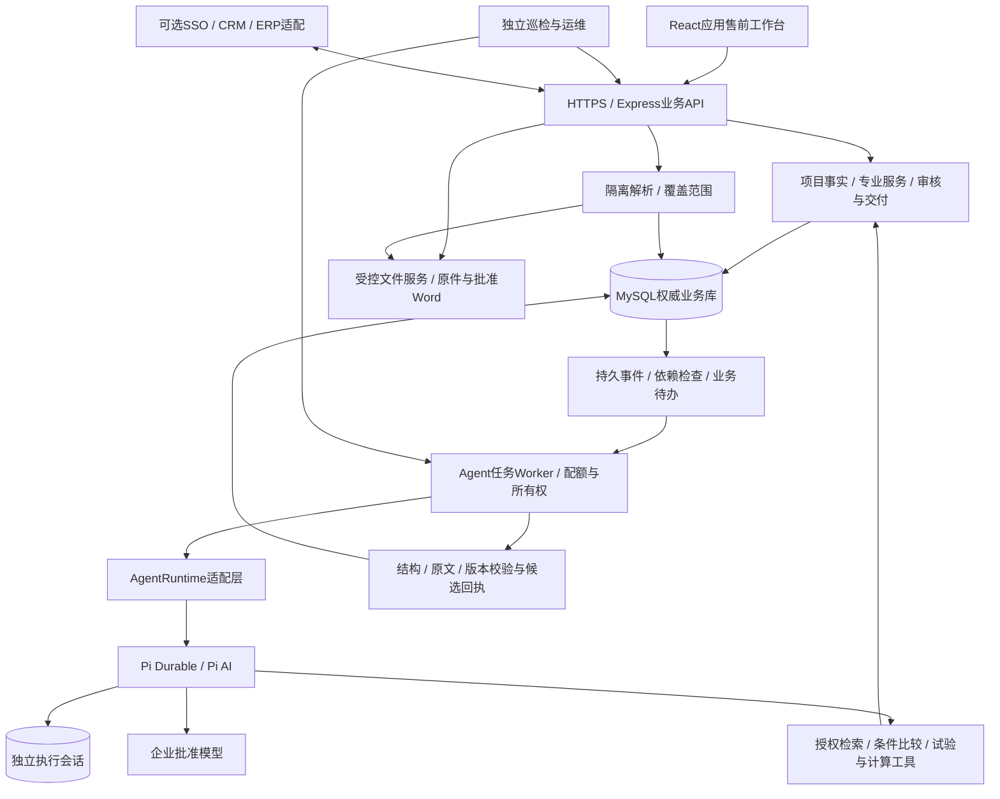

# AI原生化工应用售前工作台解决方案

| 项目 | 内容 |
| --- | --- |
| 版本 | V2.0，实施对齐修订版 |
| 日期 | 2026-11-07 |
| 项目 | ai-sales-plan |
| 定位 | 由应用工程师掌控、AI持续协助推进的化工应用售前工作台 |
| 行业边界 | 应用型化学药剂/特种化学品，首期选择一个产品族验证 |
| 状态 | 完整目标设计与当前实施对照；三批基础业务链已贯通，八方向仍有明确缺口，真实专业质量与生产验收待签收 |

本文为正式项目目标方案，建设重心是“应用诊断—推荐推理—试验验证—价值证明—方案迭代”，商机、财务、审核和归档提供必要支撑。第0章列明截至2026-11-07的实际能力和剩余差距；第1—22章保留完整业务目标与验收要求，不能把目标描述当成实现证明。当前工程设计见[设计文档](设计文档.md)，安装、入口和命令见[README](../README.md)。

阅读导航：

| 阅读目的 | 章节入口 |
| --- | --- |
| 实际完成与剩余差距 | [0 当前实施状况与剩余差距](#0-当前实施状况与剩余差距) |
| 产品定位与完整旅程 | [1 产品目标与设计决定](#1-产品目标与设计决定) |
| 化工专业工作与知识 | [5 应用档案与客户资料](#5-应用档案与客户资料) |
| AI工作方式与Pi | [11 AI如何持续推进工作](#11-ai如何持续推进工作) |
| 协作、审核与交付 | [16 必要协作与部门审核](#16-必要协作与部门审核) |
| 实施与验收 | [20 实施路线与资源](#20-实施路线与资源) |

## 0. 当前实施状况与剩余差距

### 0.1 八方向核查

核查基于当前代码、既有自动测试及本机集成记录。三批“基础链贯通”不表示八方向所有细项已经交付，更不等于真实专业质量与生产运行已签收。

| 方向 | 当前实际实现 | 剩余差距与验收重点 |
| --- | --- | --- |
| **应用事实与诊断** | 事实、假设、问题和独立结论分开；事实保存来源性质、单位/工况和确认状态；问题关联判断，答复及出处齐备后解决；同显式属性键、同单位/条件的已确认数值冲突可展示并阻断送审 | 尚无语义冲突识别、跨单位事实归一；真实专家样本须证明追问和诊断质量，引用正确不等于专业判断正确 |
| **专业证据检索** | 手选最多8份、合计60万已解析字符；2500字符分段/200重叠关键词搜索，可读长文后段；精确原文、版本/指纹和实际读取区间校验；界面显示已读/未读范围 | 尚无PDF物理页码、表格行列锚点、授权全库自动发现或语义召回；解析之外内容不可检索；OCR/XLSX未实现 |
| **产品与路线推荐** | 保存候选/选定/排除、理由/反证/重新考虑条件及比较矩阵；在任务授权技术资料关联的发布参数中发现产品并作确定性比较；成功/失败案例可保存原条件、目标条件和差异，并绑定有效案例原文 | 案例条件比较仍由人工整理，尚非自动迁移引擎；跨项目经验共享缺独立去标识/复核发布链；需真实正反案例和领域规则签收 |
| **样品与试验闭环** | 计划、批次、方法、条件、对照、原始读数/单位、缺测、确定性判据和独立结论；原始数据不可覆盖；失败或未知阻断相关有效路线，明确排除后保留历史 | 基础闭环具备；无仪器/LIMS导入、自动统计或放大模型；真实规程和结论质量待签收 |
| **变化影响与主动推进** | 对象修订依赖、变化事件、失效提示、人工点击AI准备修订、正文依赖快照和来源撤回限制 | 模型自动执行的预授权策略、额度/期限、事件去重执行器未实现；正文依赖仍为整体集合，尚无逐章局部补丁及独立采用合同 |
| **客户价值与财务** | 客户与内部底稿隔离；精确JSON字符串快照、6位定点BigInt计算、条件敏感性、等效假设确认；独立财务、固定公开投影与批准Word | 无独立DECIMAL统计投影、税汇模块；真实财务口径和独立参考底稿待复算签收，不用合成样板代替 |
| **商机、协作与交付** | 轻量商机、责任/期限、个人待办及完成依据；技术/合规/条件供应法务→财务→领导；实际接收对象、渠道、时间、批准版本及SHA-256登记 | 无CRM/ERP接口、跨版未办义务自动移交、外部消息或升级；旧义务保留在原版历史，需要明确人工承接 |
| **专业质量与生产运行** | 合成样板真实模型链、工程权限反例、单机Pi恢复证据；独立进程巡检检查HTTP、迁移、过期租约、队列积压和请求计数 | 真实脱敏质量/人工收益、隔离联合恢复、生产权限、SLO、Word/WPS和全部请求费用核对未验收；巡检尚未托管定时运行 |

当前界面是所有方案共用的“AI推进 / 应用与路线 / 样品与试验 / 价值与商务 / 商机、待办与交付”，原正文入口为“方案编制与送审”。阅读许可、模型许可、对客披露分开；AI结果只创建候选，不替代技术或财务签字。

### 0.2 后续实施包与退出条件

以下事项均未完成，实施顺序按权限与依赖安排；真实样本准备可与研发并行。没有真实产品和专业签收时，继续明确标注合成数据。

| 实施包 | 具体工作 | 退出条件 |
| --- | --- | --- |
| A 解析与授权资料发现 | 保存解析版本、PDF页码/表格行列锚点；检索前过滤项目/资料版本/模型许可；增加资料范围须显式确认；语义召回按样本收益决定 | 长文后段、跨页表格、撤回和跨客户反例通过；不能定位时明确“仅字符定位”，不伪造页码；已读与未读可核验 |
| B 逐章依赖与局部修订 | 章节保存独立依赖与修订；变化定位具体正文；候选补丁与采用固定章节及上游版本 | 只修改受影响章节，不覆盖无关修改；旧页冲突可处理，重复采用不重复写入，依赖变化后拒绝旧补丁 |
| C 事件预授权与有限自动推进 | 默认关闭的项目策略：负责人、任务类型、资料/模型/工具范围、请求/费用上限、有效期、暂停条件；事件按对象版本去重，执行前复核权限 | 无预授权不调用模型；撤回/到期/额度用尽/暂停立即阻断；重复事件不重复建单；自动结果仍为候选；当前阅读许可不能当未来外发许可 |
| D 受控案例与专业规则 | 源项目许可、去标识、独立复核、发布版本和迁移条件；专家规则及成功/失败案例评测 | 未获共享批准的客户材料不进入其他项目；不同方法/样品的限制可识别；独立样本证明适用性而非仅相似度 |
| E 真实业务UAT与收益 | 应用工程师/实验室提供获准脱敏样本、规程和独立评价；财务提供口径及参考底稿；目标Word/WPS目检 | 专业关键错误为0、计算逐项一致；至少一项准备工作收益有数据；真实质量、纠错负担和限制分别签收 |
| F 生产运行与恢复 | IT指定隔离恢复目标；联合备份/还原MySQL、原件、批准文件、Pi日志/检查点和回执；托管独立巡检/告警；费用对账和权限/容量验收 | 实际核对文件指纹、权限、任务及回执一致；费用覆盖成功/失败/取消请求；SLO实测并签收，不以存在脚本替代部署验收 |

CRM/ERP/LIMS、跨版义务移交、税汇或DECIMAL统计投影依业务需要另定合同，不因出现目标描述而计为完成。本文第20章阶段路线保留原始整体框架，剩余排期应以上述实施包和实际资源重估。

### 0.3 工程证据的时效与边界

截至2026-11-07，最近68项自动测试、构建、完整HTTP业务链及独立巡检已有通过记录；覆盖冲突阻断/解除和案例条件保存。此前真实Agent经过6次请求完成专业对象和长文后段读取，浏览器覆盖主工作区与窄屏；最新冲突/案例/读取覆盖补充未重跑全部真实模型与浏览器场景。本次文档整理不新增这些验收证据。

完整HTTP样板包含失败路线A保留及排除、B计划和有限通过结论、客户80元/3.2%条件复算、内部净收入/毛利/贡献、六节点审核、公开Word、实际交付、新版隔离与来源撤回。它证明工程合同与合成场景，不能推导化工推荐正确或生产已达标。本机报告位置、测试命令和历史兼容边界见设计文档及README。

## 1. 产品目标与设计决定

用户提交一个售前目标及已有材料，AI整理事实、找出缺口、调用专业工具、准备候选与验证路径；工程师判断关键事实和技术取舍，各部门确认承诺边界。客户补充、试验反馈和资料变化持续更新同一项目的判断与方案。

典型目标是：“根据这批资料判断有哪些可行产品，说明推荐前还必须确认什么，并准备验证方案。”主要产物包括应用档案、诊断假设、候选比较、试验计划、结果分析、客户价值测算和对客方案。

| 设计决定 | V2.0建设方向 |
| --- | --- |
| 产品中心 | 应用问题、证据与验证进展；Word由项目知识和确认结果组织生成 |
| AI职责 | 多步查证、专业工具调用、持续状态、事件响应和人工接续 |
| 用户入口 | 目标输入、资料投递、成果卡片和关键判断；表单用于核对和精修 |
| 行业深度 | 将工况、体系、参数性质、样品批次、试验方法和迁移条件建成对象 |
| 技术路径 | 已接入Pi AI / Durable / Chord 1.4.0，保留业务校验与运行时边界；继续补专业质量和故障验收 |
| 管理边界 | 轻量商机、项目责任、财务审核和交付；原有CRM/ERP继续承接权威业务 |
| 实施顺序 | 先打通一个真实产品族的AI专业工作链，再补协作和生产保障 |

AI原生的验收依据是专业准备工作是否被有效完成：是否减少查找、整理和反复补问，是否更早暴露不能成立的推荐，是否缩短形成可解释方案的时间。聊天量、生成字数、Agent数量均不能单独证明价值。

## 2. 行业范围与首期切入

### 2.1 以应用型售前为主线

化工业务差异很大，不能用一个模板覆盖全部企业。以下分类用于设计访谈，真实流程由首期产品族验证。

| 场景 | 典型专业重点 | 数据与功能影响 |
| --- | --- | --- |
| 标准原料/经销 | 规格、质量文件、可供性和商务 | 可以较轻，不要求每单开展试验 |
| 配方/功能助剂 | 体系相容性、性能权衡、加入条件 | 体系组成、配方版本、条件及结果 |
| 工业清洗/表面处理 | 污染物、基材、工艺窗口、效果与材料影响 | 应用诊断、对照试验、过程与结果 |
| 水处理等过程应用 | 介质特征及波动、方法、目标和经济性 | 采样背景、时间序列、条件匹配 |
| 高认证要求材料 | 杂质、批次、客户认证与变更 | 资格验证及受控变更 |

公开实例支持将应用支持、配方、选型和验证作为技术售前的重要部分：Dow列有配方及应用故障排查支持，BASF相关业务强调应用测试和工况适配。这些实例不是本企业已有能力的证明。[Dow技术支持](https://www.dow.com/en-us/support.html)、[BASF技术服务](https://fuel-and-lubricants.basf.com/global/en/about-us)

### 2.2 首期选择与示例边界

选择一个产品族和一类应用，要求有产品资料、工程师代表、成功/失败案例及可获得的试验记录。先验证查证、推荐和反馈是否有用，再扩产品族，不先建设覆盖全部化工的知识百科或自主配方研发平台。

首期已从现有方案中选定“XX电子封装清洗方案 / PCBA清洗”，使用合成板件、残留、设备及样品推进；当前所有方案使用统一工作台，不再建设PCBA专用主入口。工程验证与边界见第0章和[设计文档第10章](设计文档.md#10-验证证据与验收边界)。真实产品、现场和试验条件尚未确认，不提供直接执行的配方、混配或操作参数；实际方法由专业人员依据企业规程批准。

## 3. 人员与AI的工作分工

| 参与者 | 主要责任 | 交付 |
| --- | --- | --- |
| 销售/客户经理 | 提交问题、协调补充、记录客户沟通及交付 | 目标、原始资料、客户确认与反馈 |
| 应用工程师/售前负责人 | 确认事实、诊断和推荐取舍，统筹专业工作 | 应用档案、推荐决定、计划和方案 |
| 实验室/技术专家 | 审查方法、执行或核验试验、确认结论 | 原始记录、技术判断与适用范围 |
| 合规/EHS | 核验适用资料、安全边界和披露 | 声明、限制与补证要求 |
| 供应/质量 | 核对规格、样品批次、可供性和交期 | 供应及质量边界、有效期 |
| 财务 | 确认经济口径、独立复算、审核费用及报价 | 测算复核、获批商务条件 |
| 法务/授权领导 | 特殊条款及最终授权 | 条款边界、终审决定 |
| AI售前助手 | 授权内查证、比较、分析、准备下一步及文稿 | 有来源的产物和待判断事项 |
| 管理员/IT | 发布模板与工具配置，保障身份和运行 | 配置版本、监控、恢复和审计 |

首期采用一个主Agent按任务装配专业能力，不为每个部门堆叠独立Agent。专业能力由工作指引、工具、输入输出合同和评测样本共同定义；模型扮演“财务专家”不会获得审核资格。

工程师重点确认影响推荐的事实、技术假设、试验和正式采用。可批量核对结构化候选，不要求逐句确认机械摘录；关键判断和对外承诺不得被批量接受动作隐式批准。

## 4. 从商机到方案的完整旅程



销售提交替代现用品的目标及邮件、TDS/SDS和历史记录。AI发现基材、污染物与验收方法不清，按影响准备追问，不仅凭“效果不好”直接推荐产品。

资料补齐后，AI检索授权产品和案例，调用条件比较工具，形成A/B候选、排除理由及验证缺口。历史案例与客户方法、条件不同，须展示差异，不能视为本项目已通过。

工程师选择路线后，AI准备对照试验草案；技术人员确认再安排样品。新结果到达，AI区分已有观察、可能解释与待验证项。A未满足必要指标时，保留失败并准备B路线或停止建议，不能继续润色A的推荐理由。

确认后的结果进入价值测算和方案。客户进一步试用或需求变化后更新依赖，生成新的专业任务与修订建议，最终形成明确条件下的交付成果。

| 成果成熟度 | 用途 | 退出门槛 |
| --- | --- | --- |
| 需求澄清包 | 确认问题、条件和目标 | 未知/假设可见，不作已验证推荐 |
| 初步选型/验证方案 | 候选讨论、寄样和试验准备 | 已知禁限检查，缺证不能写成满足 |
| 经验证技术方案 | 对指定条件和指标作结论 | 关键指标有适用依据或经确认的验证 |
| 正式商务交付方案 | 对外技术及经济承诺 | 必经审核通过，披露范围与有效期固定 |

已发布依据足够支持对应结论时可经专业确认直接采用，不强制每单实验。新体系、关键条件不同或冲突时进入验证。初步交流可保留未知，正式结论不能绕过证据门槛。

## 5. 应用档案与客户资料

### 5.1 用应用档案承接原始信息

用户上传资料或粘贴获准沟通内容，AI生成档案草案，原文与字段并排核对；缺失保留未知，不把模型常识补成客户事实。

| 对象 | 首期内容 | 专业约束 |
| --- | --- | --- |
| 问题与目标 | 现象、环节、影响、期望、优先级 | 期望与可验收指标分开 |
| 应用体系 | 基材/介质、污染物/作用对象、有关组分、上下游 | 组成可能受限，不默认外发或跨客户使用 |
| 工艺与环境 | 适用的温度/压力/pH、接触时间、设备等 | 单位、范围、观察时间与来源 |
| 当前基线 | 现用品、用量、效果、缺陷、处理量 | 口述、测量、估计分别标识 |
| 性能与约束 | 指标、容差、关键性、禁限要求 | 方法、条件和验收责任明确 |
| 验证条件 | 样品、现场限制、窗口、认可方法 | 能开展试验与已经验证分开 |
| 价值与商务 | 单位产出/处理成本、数量、费用、付款线索 | 假设、估算与获批条款分开 |
| 沟通与权限 | 客户/现场、联系人、文件范围与用途 | 读取、模型使用和对客披露分别授权 |

每个事实固定原始表达、规范值、单位/基准、来源版本与位置、确认人及时间。候选、已确认、待核对、已替代分别标识；假设另存。AI置信提示不代替专业确认。

### 5.2 资料与解析

复用当前TXT、Markdown、CSV、DOCX和可提取文本PDF。当前单文件5MB、提取20万字符、PDF前50页、解析20秒/256MB；必须显示截断、未读范围和失败。OCR、XLSX、图表读数如首期需要，应在G0明确并单独验证，不能写成现有能力。

扫描件暂由人工核验摘录，保留原件和位置。AI不能从未成功解析的表格/图像声称取得数值。清单按应用模板准备，只优先追问影响当前判断的缺口，避免首次登记填写完整企业问卷。

共享资料经有权人员发布，客户资料核对主体、现场与用途。原件、指纹、版本、有效期、解析覆盖、可读对象、模型许可及披露规则分别保存；上传不等于专业认可，更新不覆盖旧原件。

## 6. 应用诊断与针对性追问

诊断结构为“现象—可能原因—支持/反对证据—排除条件—需观察或试验的事项”。允许多个假设及暂不排序，不把猜测直接写成需求或检测结论。

按是否改变选型、影响验证可比性及安全边界、影响经济判断确定追问优先级，并解释影响哪条判断。首期使用领域模板和显式规则，模型组织语言并发现线索，不宣称具备可靠的最优信息增益计算。

追问卡片须包含问题、现有依据、为什么问、谁提供/确认、不回答会阻塞什么。例如清洗场景先核对基材与质量要求，因为它影响候选适用性及观察项目；答案未知时保留范围，不作保证。

新回复到达后准备事实差异、已解决缺口与新矛盾，避免重复询问。保留客户原话与工程师解释。工程师可接受、修改或退回提取结果，修改带来源的事实时保留差异及理由。

## 7. 化工知识与证据组织

### 7.1 可比较的专业知识

| 知识对象 | 用途 | 不能据此推断 |
| --- | --- | --- |
| TDS（技术数据表）/应用说明 | 参数、建议用途、方法和典型表现 | 典型值不自动等于保证值，条件不同不能直接套用 |
| SDS（安全数据表）及合规资料 | 危害及处理信息、适用声明的专业依据 | 不证明产品效果，不构成所有用途的合规批准 |
| 规格/质量记录/CoA（批次分析证明） | 相应规格与批次检测 | 单批检测不证明客户工艺适用或长期保证 |
| 实验/客户试用 | 特定样品、方法、条件下的观察 | 实验室结果不自动等于现场表现 |
| 成功/失败案例 | 线索、限制及迁移条件 | 相似度不代表本项目成立，私有内容不能默认共享 |
| 专家规则 | 排除条件、问题、方法与输出要求 | 仅在已发布产品族和有效范围使用 |

首期词典包括产品别名、应用类型、指标、单位、方法、典型/保证/规格性质及条件关系。质量/体积百分数、有效成分/商品用量等基准须明确；密度或有效含量未知时不能仅凭单位名称换算。

### 7.2 检索与反证

本节的全库发现、语义召回和受控共享案例是完整目标；当前为手选授权资料内的关键词分段检索与原文读取，范围见第0章。

按项目、资料许可、产品族和有效性过滤后，结合关键词、结构化条件和语义召回返回可定位片段。首期可用MySQL和受控检索服务，向量索引按样本需要配置，不能成为业务权威库。

证据关系包括支持、反对、中性和适用限制；事实、假设、建议、专业结论分别保存。重要推荐主动检索反证及失败案例。未找到资料时明确未定位，不用模型记忆编造企业产品性能。

检索、片段读取和采用均检查当前权限。客户案例经授权、去标识和独立复核才进入共享库，隐藏客户名不足以保证可共享。

## 8. 产品推荐与路线比较

AI先筛明确禁限和不适用条件，再比较性能、方法、工况、体系相容性依据、供应及经济线索。未知不作满足，关键不适配不能被文本相似度或综合评分抵消。

| 产物 | 内容 |
| --- | --- |
| 候选卡片 | 产品/路线、版本、目标问题、依据、限制、缺口和验证需要 |
| 排除卡片 | 对象、触发条件、依据及重新考虑所需条件 |
| 差异矩阵 | 可比较指标、单位、方法和工况；不可比项明确标注 |
| 推荐理由 | 优先原因、代价、最强反对理由、改变推荐的条件 |
| 下一步 | 追问、测试、初步方案、正式论证或停止建议 |

首期采用硬约束、已知差异、证据成熟度与人工取舍，不强求黑箱适用率。无足够依据允许无推荐；不能根据单一组分名称推断完整体系相容。客户现用品和竞品比较也必须核对条件、方法及使用权。

## 9. 样品、试验与反馈迭代

### 9.1 验证计划

| 对象 | 必需信息 |
| --- | --- |
| 目标 | 对应需求/假设、指标、判据与退出条件 |
| 样品 | 产品版本、样品/批次ID、日期、提供人及必要状态 |
| 体系 | 基材/介质、相关组分/配方版本、基线与对照 |
| 方法 | 方法版本、条件、单位、设备/执行单位及偏离 |
| 设计 | 对照、变量、重复安排、必要边界及技术确认 |
| 结果 | 原始值、异常/缺测、计算方法、原始附件及出处 |
| 结论 | 支持/部分支持/否定/无法判断、范围、确认人和后续动作 |

AI依据发布模板准备草案，提醒缺少对照、方法、批次等要素。执行参数由技术人员批准，不把建议自动下发设备。寄样、执行、上传结果、专业确认是不同状态。

### 9.2 结果解释与迁移

AI调用确定性工具比较原始值、基线、变化及约定判据，说明缺测、异常和条件差异。原始与整理后数据分开，不能补0或静默删除异常。单次观察不直接证明因果或统计显著性；统计分析须满足适用设计与样本条件。

分别标识产品资料、内部实验、客户试用和现场确认及其范围，不把它们当成统一保证等级。放大时检查设备、物料、批次和工艺变化，形成迁移待办；结果不支持时调整路线或停止。

首期支持描述性比较和模板化验证，不默认具备自主DoE（试验设计）优化、分子设计或可靠性能预测。需要此类能力时另建数据及专业模型验证合同。

### 9.3 失败与经验

保留无效果、指标不满足、负面影响、条件不明确、方法不适配等失败及原始证据。AI准备案例摘要、迁移条件和避坑提示，由技术及资料所有者复核发布。

经验沉淀采用受控检索和版本化规则，不默认使用客户数据微调。AI产物不能经自身引用变成独立证据；反馈改进须用未参与配置的样本检验。

## 10. 客户价值与内部商务测算

### 10.1 客户应用经济性

先确认同一处理量/产出、合格标准、期间、用量基准和费用边界；未证明等效时只作有条件的情景比较。

```text
单位合格产出成本 = 同一期间纳入的应用总成本 ÷ 合格产出量
应用总成本 = 药剂费用 + 已确认相关的能耗/水耗/人工/处置/维护等费用
条件下预计差额 = 可比基线总成本 − 候选情景总成本
```

费用项目按产品族选择，有依据才计入良率、返工或停机影响，避免重复计入同一损失。未知不补0；AI组织假设和解释，公式、换算及敏感性由确定性工具执行，技术和财务分别确认范围与口径。

合成算例：同一期、同等合格处理量1,000单位；A用100kg×20元/kg，B用80kg×24元/kg，其他已确认可比费用均为500元。A总成本2,500元、单位成本2.50元；B为2,420元和2.42元；条件下差额80元/期，降幅3.2%。此例只验证计算，不证明实际等效或节省已经发生。

### 10.2 内部财务与报价

内部独立记录成本、包装物流、样品/检测/服务费用、折扣、信用、付款、币种/税口径及有效期。净收入、毛利、未重复计入专项费用后的项目贡献分别计算，计划、应收及实际到账分开。

以财务批准的不含税口径为例：净收入为数量乘净单价再扣未体现的折让；毛利为净收入减按固定口径计入的销售成本；项目贡献再扣未重复计入的专项费用。毛利率/贡献率分别除以净收入，资金成本如适用另列。费用归类、折扣及舍入顺序在独立样板中固定，不能由AI临时改变。

正式对客方案保留财务节点：纯技术成果核对费用/赠样/经济承诺，含报价或特殊条款时核对完整底稿。阈值、例外、税务与舍入口径由财务发布，本文不虚设金额。

数量、金额、单价各定义精度和基准；服务端用十进制或整数算法，API传十进制字符串。当前实现将原始精确字符串保存在不可变JSON版本快照，以6位定点BigInt计算；尚无独立MySQL DECIMAL统计投影、税额或汇率模块。若增加统计投影，须与原快照逐项对账；不能先转JavaScript浮点数损失精度。分母为0时比例标为不适用，独立参考样板逐项复核。[MySQL精确数值机制](https://dev.mysql.com/doc/refman/8.4/en/precision-math.html)

客户价值与内部利润底稿分别授权，对客只披露复核后的假设、结果和获批条款；底价、信用和内部评语不进入文件正文、附件、批注或元数据。

## 11. AI如何持续推进工作

### 11.1 目标、计划、执行、检查与接续

每个AI工作任务绑定明确目标、授权范围、输入修订、预期产物和停止条件。主Agent生成可观察的步骤，调用检索/比较/计算工具，检查是否覆盖必要问题；遇到关键未知转入等待人工或外部资料，不无限循环查找。

对已获授权的只读查证和工作草案整理，可在预算内连续执行，不逐次打断用户。确认关键事实、执行试验、采用技术结论、正式审批及发送客户等动作在相应人工节点完成。等待客户几天的业务任务保存在MySQL，回复后创建新的执行尝试；不让模型会话持续占用计算资源等待。

### 11.2 事件驱动和有限主动性

本节定义目标行为。当前已实现确定性事件与人工点击准备修订，尚未实现模型自动执行的预授权对象和事件消费者。

| 事件 | 确定性处理 | 允许AI准备的工作 |
| --- | --- | --- |
| 新资料解析完成 | 校验范围、指纹和覆盖 | 档案候选、缺口、相关片段和冲突线索 |
| 工程师确认需求 | 固定修订、定位依赖 | 针对变化重查产品/案例、推荐差异 |
| 试验结果确认 | 校验方法、样品和原始值 | 对比、解释候选、下一步与正文修订 |
| 产品资料撤回/过期 | 立即阻断相关读取/采用/批准/新下载 | 在当前许可内整理影响及替代查证任务 |
| 客户反馈或成本变化 | 保存事实及来源，标记受影响对象 | 更新问题、条件情景及方案候选 |
| 审核退回 | 关闭本轮未办节点 | 按意见定位修改点和待补材料 |

默认对业务事件做确定性影响检查和站内提示。模型自动执行须有项目负责人明确启用的预授权策略：任务类型、允许资料/模型、工具范围、调用/金额估算额度、有效期及暂停条件；否则等待用户点击“准备更新”。启用策略也不能绕过单份资料外发许可或当前人员权限。

同一事件、对象版本和任务类型合并去重。执行中再次变化时保留当前固定输入，旧结果标记待核对，新变化进入后续任务，不自动用自己的草案写回制造触发循环。没有可行动变化时保持安静，不周期性调用模型重写相同内容。

### 11.3 执行与业务状态

执行状态为待受理、排队、执行中、等待人工/外部、成功、失败、取消；“成功”仅表示约定产物已生成。专业结论、批准和交付保持自己的业务状态。

任务详情显示当前步骤、已读范围、引用、工具结果、失败原因、耗时和用量。展示可审核的依据及决策摘要，不要求保存或展示模型隐藏推理。缺资料、模型故障、权限变化和版本冲突分别给出下一步。

## 12. 专业工具与操作授权

工具是带合同和权限的业务能力，不直接开放数据库、宿主文件或任意网络。以下为完整目标合同；当前部分能力由受控业务API和现有Agent工具组合实现，不意味着每个示例工具名均已独立提供。实际覆盖见第0章；当前五个Agent工具及业务服务分工见[设计文档](设计文档.md#5-pi执行候选与采用)。

| 工具类别/示例 | 作用 | 边界 |
| --- | --- | --- |
| search_evidence / read_excerpt | 检索与读取授权原文 | 固定项目/版本/片段，不接受任意路径 |
| get_application_profile | 读取已确认档案和未知项 | 字段级授权，带修订 |
| compare_product_conditions | 比较单位、方法、工况和性质 | 确定性判断，保留不可比与未知 |
| retrieve_application_cases | 比较成功/失败及迁移条件 | 仅授权案例，返回适用差异 |
| prepare_test_plan | 依据专业模板准备验证草案 | 不生成已批准执行状态 |
| analyze_test_results | 计算对照、变化、判据及覆盖 | 原始数据及分析合同固定 |
| calculate_application_cost | 客户价值、敏感性和内部测算 | 服务端公式及独立财务权限 |
| propose_profile_patch / propose_solution_patch | 保存字段/正文差异候选 | 不覆盖已确认事实或正式版本 |
| propose_followup_task | 准备补件/验证任务 | 不对外发消息、不自动分派超出范围人员 |
| inspect_dependencies | 定位变化对推荐、测算和正文影响 | 显式关系，不能声称覆盖全部语义影响 |

授权分三类：只读检索/计算在任务范围内执行；草案及候选可在预授权工作区落库并保留来源；确认、专业签字、最终采用、正式下载/交付和配置发布由业务服务及有权人员办理，不提供给模型自批工具。

每次工具调用复核当前身份、资料许可、对象修订、参数、预算和取消。涉及候选落库的工具在MySQL事务内使用稳定幂等键和回执；中断后先查回执，不因运行时重放再建一条。首期不开放Shell、任意SQL、任意URL或自动邮件发送。

## 13. Pi执行底座与首期验证

### 13.1 选型决定

服务端Agent执行层已经使用Pi AI + Pi Durable + Chord组合，正式运行依赖锁定为1.4.0，调用配置的真实模型，不是仅有离线PoC。该版本不视作当前最新版本，升级仍需接口、兼容性和维护风险核验。Pi提供执行基础，不承担化工知识、企业权限、专业审核和CRM业务。

参考的1.4.0官方文档描述持久会话、模型/工具任务及恢复，并标注Experimental。恢复能力与工具重放有条件，需要本项目故障验证。[Pi Durable 1.4.0官方说明](https://raw.githubusercontent.com/earendil-works/pi/v1.4.0/packages/durable/README.md)

| 组件 | 目标职责 | 本项目仍须实现 |
| --- | --- | --- |
| Pi AI | 模型适配、请求/结果、用量 | 批准模型、外发控制、额度与账单核对 |
| Pi Durable | 多轮任务、持久会话、观察、取消与恢复 | 所有权、恢复对账、业务回执和工具策略 |
| Chord | 所选Pi版本要求的执行上下文基础 | 版本兼容验证，不作为业务数据库 |
| AgentRuntime适配层 | open / run / cancel / usage / close等生命周期 | 与现有ModelRuntime、Worker和候选合同衔接 |

当前已实现工具循环、任务预算、单机执行日志和人工接续；生命周期和故障边界见设计文档第5章，余下专业收益及生产恢复仍须验收。MySQL是项目、事实、结论、候选、批准及任务的权威库；Pi会话保存单次执行状态；浏览器保存未提交输入和显示状态。三者不能互相替代。

### 13.2 执行、恢复与人工接续

1. API核验当前身份、修订和许可，在MySQL登记固定输入、授权清单、策略版本和业务任务ID。
2. Worker取得单一所有权，通过适配层打开该执行尝试的独立会话，稳定请求ID与Submission关联。
3. 工具只读取任务获准范围；每次外发、工具与恢复前重新核验当前许可和取消。
4. 阶段产物以候选和回执落MySQL；Pi完成不自动改变技术结论或审批。
5. 等待人工时保存所需问题和依据，释放执行资源；人确认后的新修订启动新任务，引用上次产物但不沿用过期授权。
6. 同一输入的执行中断可尝试恢复检查点；输入变化则创建新尝试。会话丢失/损坏明确失败，不能用空会话伪恢复。

只读工具可按实际语义声明安全重放；候选写入还须业务幂等，审批及对外发送不进入Agent重放范围。Pi请求ID不能保证外部模型零重复计费，也不能提供跨MySQL、文件与会话的天然事务。

单任务会话一次只能由一个所有者打开。锁连接丢失时停止后续执行并关闭会话，确认旧所有者停止后受控接管。备份覆盖会话及所选存储需要的WAL/检查点，不能随意复制正在写入的SQLite主文件当作完整备份。

### 13.3 专业收益与故障补验门槛

已有合成样板真实模型、HTTP、浏览器及部分单机恢复证据，但尚不能替代以下补验。用同一模型、相同授权文档和真实脱敏问题，对比人工/单次生成与Pi工具任务。分开测量：相同证据下的运行差异，以及同一文档范围内新检索策略带来的差异，避免把检索收益全部归功于框架。

核心样板为“资料整理—追问—产品比较—验证草案”和“新试验结果—分析—修订建议”。同时测试长文后段证据、冲突、撤权、取消、超时、工具写入后丢回执、数据库中断、会话丢失和Worker重启。

通过条件：无越权、重复采用或重复候选事实；故障有明确状态；关键数值/条件保真不低于基线；至少一项专业工作耗时或查证完整性获实际改善；调用、延迟、成本和维护代价可解释并获工程师/IT接受。

补验未通过时列明缺陷、适用范围和改进/替代路线，已有人工编制可承接业务；不得把工程工具循环接通宣称为专业收益和生产验收通过。替代运行时仍须满足同一专业和恢复合同。

## 14. 工作台与交互

### 14.1 项目主页

项目主页围绕“当前问题—已有依据—正在做什么—等待谁判断—下一步产物”。提供目标输入和资料投递，AI执行进度旁固定展示应用档案、候选、试验、价值与方案卡片；对话用于提出目标和追问，关键事实与结果保存为可编辑、可引用的业务对象。

| 工作区 | 主要交互 |
| --- | --- |
| 项目总览 | 目标、关键未知、专业进展、AI任务、阻塞与下一步 |
| 应用与证据 | 原文/字段核对、事实/假设、冲突与授权范围 |
| 产品与路线 | 候选及排除理由、条件矩阵、案例差异、工程师取舍 |
| 样品与验证 | 计划、批次、原始数据、对照及确认结论 |
| 价值与商务 | 客户经济性、敏感性、授权内部底稿和获批条款 |
| 方案与交付 | 自动准备的正文/引用差异、部门意见、批准及文件 |
| 我的判断与待办 | 关键确认、补件、验证、审核和客户反馈 |

### 14.2 人机协作细节

AI提出修改时显示字段/段落差异、来源、新增假设和受影响内容。工程师可接受全部安全范围内的候选、逐项调整或退回；涉及技术结论时进入单独确认。弃用候选不能删除其关联事实与旧历史。

进度显示真实阶段，例如整理资料、读取证据、比较条件、等待基材信息；不使用虚假的完成百分比。资料部分解析、模型失败、权限不足、零结果和确实未发现问题分别表达。

保留未保存输入；冲突不能静默覆盖。切项目或撤权后取消旧请求并清理无权正文/历史/候选。桌面完成专业工作，平板阅读审核，手机首期用于待办及轻量查看。关键任务支持键盘和原文定位，不只依靠颜色区分状态。

## 15. 项目知识、数据与系统架构

### 15.1 核心关系



这是逻辑模型。实际实现还须有资料版本、证据关系、样品/批次、候选差异、专业确认、授权、任务回执、审核节点、披露和交付对象。任何关联都不直接带来读取权限。

显式关系记录“事实来自哪里、假设依据什么、推荐排除了什么、试验验证什么、结论支持哪条推荐、方案引用哪个结论”。先用关系表和版本指纹实现，不先引入独立图数据库。

### 15.2 目标部署



沿用React/TypeScript/Vite、Express、MySQL和Word基础，新增专业领域服务及Agent适配层。首期模块化单体配独立Worker/解析单元，分环境部署，不先拆大量微服务。

MySQL保存业务任务、事实、版本、固定运行、审核和事件；Pi会话独立持久化。任务进度通过轮询或SSE读取；页面连接不决定后台任务生命周期。生产Node、MySQL及Pi实际版本在技术评审中核验维护期和依赖兼容，锁文件固定。

### 15.3 接口与并发合同

下列为逻辑合同示例，不代表实际路由。当前领域API以`/api/proposals/:id/project`为入口，正式审核/下载沿用原方案接口；未实现的预授权策略路由不能据此调用：

| 接口领域 | 示例 | 关键要求 |
| --- | --- | --- |
| 目标及执行 | POST /api/projects/:id/agent-tasks | 固定目标、输入修订、资料/模型/工具范围 |
| 事实核对 | POST /api/projects/:id/profile-adoptions | 明确候选和字段，保留原文与差异 |
| 路线比较 | GET /api/projects/:id/recommendations | 读取依据与排除理由，按当前权限投影 |
| 验证与结果 | POST /api/validation-plans/:id/test-runs | 样品/方法/条件/原始数据可追溯 |
| 专业确认 | POST /api/test-runs/:id/conclusions | 人员资格、独立性和有效范围 |
| 固定测算 | POST /api/projects/:id/cost-runs | 输入、公式、输出及依赖由服务端固定 |
| 采用与审核 | POST /api/solutions/:id/review-rounds | 事务内预检、固定完整包与规则版本 |
| 任务策略 | POST /api/projects/:id/agent-policies | 有权人明确范围、额度、期限和暂停条件 |

写操作携带稳定requestId、expectedRevision及对象/版次ID。同请求同身份同内容返回原回执，同ID不同内容拒绝。关键状态转换用事务/行锁；业务变更与Outbox同事务登记，消费者幂等并可对账。

字段采用、专业确认和正文保存可在对应领域拥有独立修订，依赖快照记录各版本，避免无关草稿保存让所有工作失效。无法确定影响时保守要求复核。时间统一UTC存储、按企业时区显示，业务期限按约定日历计算。

## 16. 必要协作与部门审核

### 16.1 轻量商机与责任

商机只收客户/现场、业务问题、来源、销售责任、时间和价值线索；受理后建立售前项目及专业任务。查重提示由主管确认，不因名称相似自动合并。暂缓、终止和重启保留原因及记录。

已有CRM时客户/商机以CRM为准，平台关联外部ID；没有CRM时可作为单一售前入口。合同、订单、采购、开票及实际收款仍由原系统/流程承接。项目转交不自动开放其他客户资料。

任务记录目标、责任/确认人、期限、阻塞和完成依据。上传不等于资料核验，寄样不等于验证，阅读通知不等于审核。离任/撤权的未办任务待重派，提醒和升级不自动批准。

### 16.2 审核集中在成果与承诺边界

| 节点 | 适用与职责 |
| --- | --- |
| 技术 | 确认诊断/推荐、关键性能、证据适用、试验和结论边界 |
| 合规/EHS与披露 | 适用资料、必要限制、对客声明和共享范围 |
| 供应/质量 | 发生具体规格、批次、定制或交期承诺时核对 |
| 法务 | NDA/IP、排他、非标准保证和责任条款等触发 |
| 财务 | 客户价值口径及内部费用/报价/信用/付款，按成果简化或完整核对 |
| 领导终审 | 所有必经专业与财务有效通过后授权正式交付 |

工程准备和部门预沟通可并行，不把每次AI查证都变成审批。正式对客成果送审时固定内部与对客内容、资料/结论、测算、模板、规则及人员。专业节点可并行，通过后财务及必要例外授权，再终审。

触发条件未知不能默认为不适用。专业资料发布、测试结论确认、财务复核及管理批准各有资格；财务编制人与审核人不同，方案创建人/负责人不能自审，技术、合规、财务及终审保持独立。委托限定职责、对象、期限和读取范围。

任一退回/否决即关闭该轮未办节点。实质改动后新轮次重新审核，首期保守不自动复用旧签字；领导不能替代安全、关键性能或必要专业确认。发布前条件阻断，发布后义务有责任和期限，二者不得随意互换。

## 17. 方案生成、交付与变化

### 17.1 内容由确认知识生成

沿用当前六章作为交付视图，补充推荐决策摘要及适用商务附件。应用档案、推荐、试验和价值对象先形成，章节是其可读表达，不能出现正文已改而结构化结论仍旧且无人察觉。

| 内容 | 生成来源 |
| --- | --- |
| 客户应用场景理解 | 已确认事实、目标与明确假设 |
| 性能约束与应用边界 | 指标/方法/工况、禁限与未知 |
| 产品推荐与匹配依据 | 候选比较、排除理由、已确认结论 |
| 现用或竞品比较 | 可比条件、来源与局限；可选 |
| 样品测试与验证 | 已有结果、方法/批次、后续计划 |
| 安全合规与风险 | 必要声明、限制与未完义务 |
| 决策摘要/价值/商务附件 | 推荐理由、价值假设、获批条款和有效期 |

AI准备全文和差异，可人工精修并保留新的证据关联；禁止摘要扩大正文承诺。初步选型、验证计划和正式方案使用不同成熟度标识。首期以Word为正式文件，PDF和任意模板导入另行验证。

### 17.2 冻结与交付

批准固定逻辑内容、披露投影、依赖及渲染配置。正式Word必须由对应快照生成并保存原件、大小、SHA-256和渲染版本；内部包含需求、来源索引、推荐/验证、测算、风险、审批及manifest，敏感底稿独立授权。

生成失败保留批准事实，但阻断交付；相同批准输入受控重试，不能悄悄替换已交付文件。重复下载优先取原件，跨渲染升级不冒充旧文件。文件与数据库无跨介质事务，采用暂存、核验、登记可用及对账。

销售登记接收对象、时间、方式、版本和文件指纹，首期在既有渠道人工发送，平台不自动外发。下载不等于已交付，客户接受不等于签约或收入。移交包括获批边界、有效期和未完义务。

### 17.3 持续影响与版本

工作修订、审核轮次、批准版次、实际文件及交付记录分别保存。事实、条件、方法、产品、成本或许可变化时定位受影响假设/推荐/结论/测算/正文，准备复核或新版；旧决定和旧原件保留。

来源撤回、授权失效和到期的访问/批准/下载限制同步生效，不等待后台巡检。历史批准的当前有效性与当时批准事实分开显示。已经发送的文件无法技术收回，重大变化产生通知客户的业务任务并记录处理结果。

## 18. 权限、资料使用与安全

权限由有效身份、职责、项目关系、字段/资料范围及操作资格共同决定。部门归属或管理员角色不自动获得所有客户和成本；工具、检索、历史、任务、日志、缓存、成果和统计同样过滤。

读取、模型外发、对客披露分别授权。模型许可包含批准通道可用、仅认可摘录、禁止外发、未确认；未确认不放行。仅内部资料也须明确批准具体私有模型通道。原件限制传递至候选、摘要和正文，共享投影须另行复核。

资料内容中的指令不改变系统权限。模型服务端持钥，解析单元无模型密钥、无审批能力并限制网络/宿主访问；类型和内容检查、资源上限、受控存储及下载共同实施，不能只信任扩展名。[OWASP文件上传防护](https://cheatsheetseries.owasp.org/cheatsheets/File_Upload_Cheat_Sheet.html)

保留HTTPS、会话撤销、CSRF、输入校验、参数化查询和登录限流；服务与迁移账号分离，密钥不进入浏览器或普通导出。撤权阻断后续读取及模型调用，但不能追溯撤回供应商已收到内容。

审计记录操作者、有效职责、对象/版本、请求/任务、工具、结果和关键决定，普通日志不写原文/密钥。保留期、客户资料删除和争议保全由企业确认，不因删除请求直接抹除批准依据。客户经验共享与模型训练均须独立授权。

## 19. 集成、运行与恢复

### 19.1 企业集成

| 系统 | 交换内容 | 权威与替代 |
| --- | --- | --- |
| 身份/组织 | 稳定用户ID、部门、在岗及SSO | 企业身份为准，平台映射项目/专业权限；无SSO时受控账号回收 |
| CRM | 客户、商机、责任和反馈 | 有CRM时为主数据源，接口未就绪用经核对登记 |
| ERP/产品主数据 | 产品编码、规格、成本/价格依据 | 记录实际使用版本，缺接口用受控录入/CSV及独立确认 |
| LIMS（实验室信息管理）/实验记录 | 样品、方法、原始结果和结论 | 原系统保留权威，首期上传/约定模板导入 |
| 企业消息 | 必要摘要及办理链接 | 默认站内；自动外部通知须单独启用，不带敏感底稿 |

批次、外部ID、源修订和指纹去重，冲突进入核对；不静默覆盖已确认知识。出站用Outbox与回执，通知失败不伪装成功。模型/API故障时现有人工流程可用，但不据此声明AI新主线已完成。

### 19.2 容量与服务目标

以下为G0讨论基线，均待实测：100具名用户、20同时在线、10同时编辑/审核，5个近同时AI任务按限额排队；普通API在约定数据规模下P95≤2秒，代表Word生成P95≤30秒，正常待办可见≤60秒。模型/解析不混入普通API平均值；AI耗时、排队、费用和工具覆盖单独报告。

RPO≤15分钟、RTO≤4小时、月度99.5%可用性为建议目标，须明确环境、维护窗口及外部依赖。单活动Worker并不等于高可用，扩并发或副本前验证所有权、会话归属和供应商额度。

### 19.3 可观测、备份和发布

监控API、数据库、文件核验、队列年龄、Worker心跳及有效进展、模型调用/费用、Outbox和备份。独立巡检负责发现Worker停止，避免执行器停止后也停止监测自己。没有业务变化时不向用户重复报平安。

联合备份包括MySQL及增量恢复材料、原件、批准文件、manifest、Pi会话及相应检查点/WAL、配置版本和回执。密钥按秘密管理策略独立保存。固定一致恢复窗口或可对账恢复点，隔离环境实恢复并验证原件、版本、权限和任务。

发布保存应用/依赖/迁移版本、配置差异、备份及回退方案。新增表沿用实际父键字符集/排序规则，验证首次和重复迁移；缺表不能按旧审核规则放行。新业务已写入后不得覆盖旧备份抹除事实，采用兼容或前向修复。

## 20. 实施路线与资源

### 20.1 先证明专业价值，再扩管理范围

以下是项目启动时的完整阶段框架及12—14周资源讨论基线，不是从当前重新计算的剩余工期或交付承诺。G1运行底座和G2/G3基础业务链已实现；G0真实领域签收、G2预授权/局部修订、G4/G5仍有未完成事项，实际后续按第0.2节推进并按投入重估。

| 阶段 | 讨论周次 | 交付与退出条件 |
| --- | --- | --- |
| G0 领域与样板 | 第1—2周 | 一个产品族、应用词典、产品/案例资料、专家规则、关键问题、评测集及授权清单签收 |
| G1 Pi与专业闭环PoC | 第3—4周 | 目标输入到档案/追问/候选/验证草案的多步任务；同输入对比及撤权、重启、幂等验证，有价值再通过 |
| G2 应用与验证工作台 | 第5—7周 | 事实/假设/推荐、样品/试验、结果分析及人工确认，接入事件准备更新和有限预授权 |
| G3 价值与完整成果 | 第8—10周 | 客户价值及内部测算、方案组织、轻量商机、部门审核和对客Word，打通原始目标至交付 |
| G4 加固与业务UAT | 第11—12周 | 独立样本、权限反例、必要集成、实际Word/WPS、容量及联合恢复签收 |
| G5 试点与扩围决定 | 第13—14周 | 有限团队/产品运行观察，记录专业收益与问题，决定扩产品族及接口范围 |

G1未通过时明确缺陷、改进期限及运行时替代评估，不自动越过门槛。不能先完成全部商机审批页面，再到项目末尾补一个AI入口。每批都向工程师展示真实输入、工具、依据及产物。

### 20.2 资源与工作量

业务负责人负责范围及跨部门协调；产品/领域分析1名持续参与，建议至少2名研发覆盖前后端、专业数据和Agent运行，1名测试从G0介入，交互/IT/安全/运维参与关键阶段。应用工程师与实验室代表须持续提供资料和评判，不只在最终验收出现；财务、合规和供应指定签收人。

预算分为领域资料整理、应用与Agent开发、模型评测/调用、计算与存储、必要集成、验证试点和运维。G0后按样本和投入估算，不假定换用Agent必然节省开发成本。首期不含自主配方研发、自动实验设备控制、完整CRM/ERP、自由流程设计器和跨企业SaaS。

### 20.3 复用、改造与迁移

| 当前基础 | 新项目处理 |
| --- | --- |
| 资料原件、引用、有效期与外发许可 | 复用并补充片段覆盖、专业结构与案例许可 |
| 参数条件匹配 | 复用确定性规则，增加产品族基准和可解释工具合同 |
| 六章/候选对照/采用/Word | 复用输出链，正文来源扩展为已确认项目知识 |
| ModelRuntime / MySQL任务 | 保留旧场景；新增AgentRuntime与执行尝试，不假冒现有任务已可恢复 |
| 原五角色/三类审核 | 已扩展八角色及财务、条件供应/法务节点；保留旧批准合同，不追造历史签字 |
| 当前客户与方案 | 盘点实际数据、补充历史来源标记，不伪造原商机或财务签字 |

现有方案不自动转换为已验证应用案例；旧批准保留历史，新制度下交付补齐所需核验。演示账号和合成数据不迁入生产。当前阶段完成情况以第0章对照表和设计文档的验证证据为准，不能将局部工程通过当作本方案整体完成。

最终交付包括主方案、专业词典/模板、工具合同、评测集与基线、Pi执行验证、领域数据和迁移、财务独立样板、对客成果、操作说明、UAT与恢复记录，以及试点收益/遗留项。仓库项目说明集中维护README、设计文档和本文；私有样本、账单、账号及验收原始证据按权限另存，不混入公共文档。

## 21. 专业质量、AI收益与上线验收

### 21.1 评测集和比较方法

建议G0准备不少于20个获准脱敏/合成任务样本，至少三分之一不参与提示词和规则调试；最终数量及代表性由领域负责人确认。这个起点不证明行业泛化能力。包含资料完整、关键缺失、长文后部证据、条件不匹配、冲突、无可行推荐、失败试验和客户反馈变化。

每例记录模型/提示/规则/工具版本、允许资料、期望关键问题、可接受路线、必须指出的未知、禁止承诺和专家依据。不能把一份专家偏好文案当作唯一答案；先评价事实、条件、推断和推荐依据，再评价表达。

比较当前人工/单次生成基线与新Agent，固定问题与授权资料；运行底座与检索策略分别对照。工程师记录主动工作时间、查证遗漏、关键纠错、候选修改、总周期、调用/耗时及账单。建议用任务完成质量、关键事实准确性、证据支持、反证覆盖、单位/条件保真、人工工作量分别判断，不以整体平均分掩盖关键错误。

### 21.2 验收矩阵

下表是完整验收规格。已有工程覆盖及证据时效见第0章和设计文档第10章；未逐项签收前不能整体标为通过，历史演示、合成工程测试也不能替代真实专业验收。

| 编号 | 场景 | 必须达到的结果 |
| --- | --- | --- |
| V01 | 原始材料生成应用档案 | 候选可追溯，未知不补事实，关键字段可批量核对 |
| V02 | 缺基材/方法/工况等 | 追问有影响说明和优先级，不直接给保证推荐 |
| V03 | 事实与诊断假设 | 客户原话、推断、观察和结论明确区分 |
| V04 | TDS/SDS/CoA混用 | 各自用途正确，不能据安全资料证明应用效果 |
| V05 | 单位、有效成分和基准缺失 | 不强行换算，未知与0分开 |
| V06 | 典型值/保证值及条件不同 | 关键不适配不被评分抵消，不可比项可见 |
| V07 | 推荐、排除和无解 | 给出依据、反对理由、改变条件；允许不推荐 |
| V08 | 案例相似但条件不同 | 显示迁移差异，不能当作本项目已验证 |
| V09 | 长文后部证据/部分解析 | 在授权覆盖内定位，未读范围和漏项可见 |
| V10 | 验证草案 | 样品、方法、对照、判据齐备，执行前专业确认 |
| V11 | 缺测、异常、少量观察 | 不补0、不静默删除，不伪造因果/显著性 |
| V12 | 实验结果与现场放大 | 结论限定条件，明确迁移所需验证 |
| V13 | 失败试验 | 更新推荐或停止建议，失败和反证不被删掉 |
| V14 | 客户价值与内部利润 | 不同模型与权限；合成算例和独立样板逐项一致 |
| V15 | 未等效效果的成本比较 | 显示条件假设，不声称已节省；零分母正确 |
| V16 | 目标到多工具任务 | 真正完成查证/比较/草案，步骤与引用可观察 |
| V17 | 事件与预授权 | 默认不隐式外发，范围/额度受限，重复事件不循环建单 |
| V18 | 等待客户后再接续 | 业务状态持久化，新输入新尝试，不使用过期上下文 |
| V19 | Pi中断、取消与超时 | 停止后续工具/模型，恢复或明确失败，实际重发可解释 |
| V20 | 写入后丢回执/锁丢失/会话缺失 | 无重复业务事实、无双所有者、无伪恢复 |
| V21 | 资料注入、跨客户与撤权 | 工具不能扩大权限，检索/历史/候选/缓存同样受控 |
| V22 | 自审、漏节点及条件未知 | 服务端阻断，人员不足待分派，不默认免审 |
| V23 | 并行退回、旧页提交及改稿 | 旧轮关闭，新轮重审，回执幂等且不丢稿 |
| V24 | 对客文件及重复下载 | 无内部底稿，来自批准投影，同版取得原件 |
| V25 | 资料/成本到期与交付后变化 | 新使用受限，旧事实保留，处置及新版可追踪 |
| V26 | 经验共享与反馈 | 独立复核后共享，私有材料不外溢，不自证正确 |
| V27 | 模型关闭或集成故障 | 人工承接可用，故障与资料新鲜度可见 |
| V28 | 实际Word/WPS与浏览器 | 中文、长表、分页、原文定位和主要任务可用 |
| V29 | 联合恢复及迁移回退 | 原件/成果/会话/权限/回执一致，关键缺失阻断 |
| V30 | 专业收益与容量 | 达到G0冻结的任务质量/SLO，实际人工工作量和费用可解释 |

### 21.3 上线门槛

需应用工程师/实验室、技术合规、财务及IT/安全/运维分别签收。关键错误接受数为0：包括越权、编造企业关键参数/试验结果、未经确认作保证、金额错误、自审和批准绕过。此标准适用于验收样本，不能推导生产永无错误。

Pi故障、关键专业反例、财务独立复算、Word目检和联合恢复须有证据；真实样本应证明至少一项专业准备工作收益，且没有因AI增加不可接受的纠错负担。未达到专业价值门槛，不以页面齐全或生成流畅宣布成功。

试点先限定团队、产品族和任务类型，保留关闭事件自动执行的开关。扩围依据新产品族资料、专家规则和独立样本重新验证，不沿用一个领域的通过结论。

## 22. 启动决策与主要风险

| 事项 | 默认方向 | 责任与时间 |
| --- | --- | --- |
| 产品族、客户问题及代表资料 | 单产品族/应用，包含成功与失败 | 业务负责人、工程师，G0 |
| 指标、方法、条件及禁限 | 发布专业词典和模板 | 技术/实验/合规，G0 |
| 关键事实与成果成熟度门槛 | 澄清、初步、验证和正式成果分开 | 售前/技术，G0 |
| Pi实际版本和部署 | 当前锁定1.4.0；后续升级及生产部署补兼容、故障与恢复验收 | 研发/IT，G1及上线前 |
| 模型、数据外发和预授权 | 批准通道、限范围/额度/期限，默认不自动模型执行 | 安全/业务/IT，G1前 |
| 价值口径与内部报价 | 独立模型、样板、权限和授权阈值 | 技术/财务，G0初版、G3冻结 |
| CRM/LIMS/ERP及SSO | 明确权威来源；SSO若为准入则前置 | 业务/IT，G0 |
| 评测集及质量/收益标准 | 保留独立样本，关键错误单列 | 工程师/测试，G0 |
| 保留期、共享案例与披露 | 独立复核、撤回和删除规则 | 法务/安全/资料所有者，上线前 |
| 工期、容量、预算和恢复 | 按真实工作量及PoC重估 | 项目负责人/IT/财务，分门槛确认 |

主要风险及处置：专业资料不足时先补领域样板，不能用模型常识兜底；生成结论可能过度外推，须以条件、反证和独立确认约束；事件执行可能失控，须限额、合并及暂停；客户案例可能泄露，须权限过滤及独立共享复核；实验计划可能无法现场实施，须在草案阶段由实验/客户代表核验；运行时实验接口可能变化，须锁定依赖并保留替换边界。

另需防止范围再次偏向通用CRM/OA：新需求按能否推进应用判断与方案价值排序，完整管理系统另立范围；AI专业主线不能被管理页面进度替代。

## 23. 依据、现状与文档维护

### 23.1 当前事实和目标能力

现状核对日期2026-11-07，软件版本0.5.0、数据库迁移10。统一真实Pi工具任务、通用专业对象、试验闭环、两类经济模型、财务及条件审核和实际交付已实现基础链；模型事件自动执行、逐章局部修订和其他未完成项见第0章。人工入口、单章助手、六章模板及旧批准兼容继续保留。历史工程验证不等于真实专业和生产验收。

项目仅维护三份说明：[README](../README.md)负责安装、入口和命令；[设计文档](设计文档.md)负责实际架构、合同及验证证据；本文负责完整目标、实施差距和验收。原Pi评估、演示说明、实施方案、进展及各批记录的有效信息已合并，重复或过时文档移除。更新时不得将目标写成已实现，也不得沿用旧测试数量或旧审核合同描述新流程。

### 23.2 参考项目

参考目录为 /Users/ac/Downloads/GitHub/asset-plan/docs/plan-platform：

| 文档 | 采用的设计经验 |
| --- | --- |
| [设计文档](/Users/ac/Downloads/GitHub/asset-plan/docs/plan-platform/设计文档.md) | Pi适配、业务库与会话分离、工具授权和恢复边界 |
| [持续任务与职责待办](/Users/ac/Downloads/GitHub/asset-plan/docs/plan-platform/持续任务与职责待办解决方案.md) | 业务任务/执行任务分离、办理回执、独立巡检 |
| [业务规则与验收](/Users/ac/Downloads/GitHub/asset-plan/docs/plan-platform/业务规则与验收.md) | 独立专业/财务确认、版本与冻结、权限投影 |
| [部署与运维](/Users/ac/Downloads/GitHub/asset-plan/docs/plan-platform/部署与运维.md) | 分环境、单所有权、联合恢复与迁移兼容 |

不迁移参考项目的经营/研发融资模型、审批对象或表结构，也不把其实现状态视为本项目事实。官方Pi、行业服务及数值/文件机制资料已在相关段落链接，只支持相应机制与行业实例，不证明本平台已经达标。

本文由项目负责人维护，专业规则由对应领域签收，实际完成情况统一更新第0章，工程证据同步更新设计文档第10章。产品族、规则、工具、模型/运行时和资料策略发生变化时同步更新评测与验收影响。
