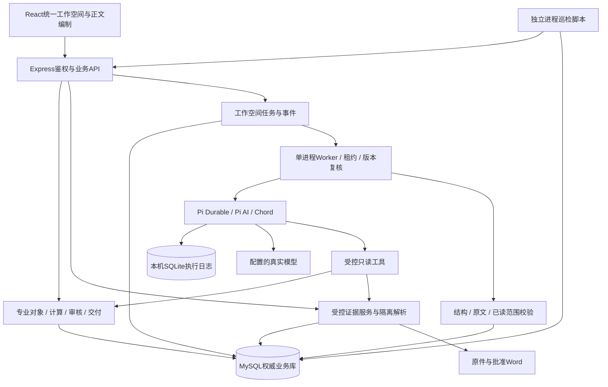

# AI原生化工应用售前工作台设计文档

更新日期：2026-11-07。项目名称 `ai-sales-plan`，软件版本 `0.5.0`，数据库迁移 **10**。本文描述当前实现；完整业务目标、未完成项与实施优先级见[解决方案](售前业务全流程解决方案.md)，安装配置见[README](../README.md)。

## 1. 设计定位与实现范围

任意方案统一进入AI工作空间，以客户应用问题、证据、专业判断和试验进展组织工作。AI产出候选；业务服务负责精确计算、权限、版本与状态；专业人员作技术确认，各部门确认承诺，最终从批准快照交付Word。

PCBA清洗是工业清洗合成样板，不是单独产品入口。早期PCBA档案接口及单章助手保留兼容，当前主线不依赖特殊方案类型。

当前已经贯通三批基础链：

1. 事实、假设、追问、证据、路线比较与排除。
2. 样品计划、原始结果、专业结论、变化影响与修订准备。
3. 客户价值、内部商务、独立财务及条件审核、Word和实际交付。

这些工程能力不等于真实化工推荐质量或生产上线已经通过。无人值守事件模型执行、逐章局部补丁、授权全库发现与生产联合恢复仍未交付。

## 2. 架构与模块



当前为模块化单体，任务Worker与API在同一Node服务内运行；解析使用隔离子进程。图中的巡检是可独立运行的脚本，尚无托管调度和通知服务。没有已部署的CRM、ERP、LIMS或SSO集成。

| 模块 | 当前职责 |
| --- | --- |
| `src/Workspace.tsx` | 统一入口、目标与资料许可、任务/工具过程、已读覆盖、候选采用与工作区导航 |
| `src/ProjectPanel.tsx` | 事实/路线、试验、价值/商务、商机/待办/交付及专业预检 |
| `src/main.tsx`、`src/Presentation.tsx` | 会话与导航、正文编制、整篇阅读、原文高亮、审批进度 |
| `server/index.ts` | API装配、会话、方案修订、正式审核和Worker生命周期 |
| `server/workspace.ts` | Agent任务受理、排队、输入冻结、授权复核、产品发现、候选采用 |
| `server/workspace-runtime.ts` | Pi工具循环、请求预算、持久日志、取消与恢复 |
| `shared/workspace.ts` | 输入/候选合同、提示构造、结构与精确引文/已读范围校验 |
| `shared/project.ts`、`server/project.ts` | 11类专业对象、版本/回执/事件、依赖、冲突、试验及金额计算、公开投影与交付 |
| `server/evidence.ts`、`server/extract.ts` | 资料范围、发布/撤回、预检、隔离解析 |
| `server/matching.ts`、`shared/matching.ts` | 产品参数版本及确定性条件比较 |
| `server/delivery.ts`、`server/rendering/render.ts` | 批准合同复核、固定公开Word、历史原件复用 |
| `server/storage.ts`、`server/operations.ts` | SHA-256文件存储；个人待办、模板、风险与账号 |
| `server/jobs.ts`、`server/model.ts` | 保留的单章候选直接模型链；不承担主Agent执行恢复 |

运行栈为React、TypeScript、Vite、Express 5、MySQL 8、Node.js `docx` 9.5.1。Pi AI / Durable / Chord固定为 **1.4.0正式运行依赖**，不是仅有离线PoC，也不声明为最新版本。Node要求>=22.19.0；SQLite适配仍需纳入升级兼容与故障回归。

### 2.1 身份、职责与人工承接

工程师负责客户资料、需求与正文；化学师负责技术资料/参数、计划与结论确认；合规负责相应资料和声明；供应质量、法务按承诺触发；财务独立复核；领导在必经节点完成后终审；管理员维护账号、模板和分工，管理身份不能替代专业资格。有效身份、项目关系、资料范围和操作资格共同决定权限。

会话撤销、CSRF、输入校验、参数化查询与登录限流在服务端实施。模型密钥留在服务端；私有资料不通过公开目录下载。角色切换需独立会话，账号失效后旧页面不能继续使用既有授权。生产HTTPS、运行账号与迁移账号分离及权限签收仍是部署责任。

文件解析、规则需求提取、参数匹配、精确计算、引用校验和审批不依赖模型。旧需求提取使用本地规则与原文位置，不能描述为模型已理解全部需求。未配置模型时可人工编制、确认和审核；AI故障不代替或自动放宽专业门槛。

## 3. 数据、修订与来源合同

### 3.1 权威状态与存储

MySQL保存方案、事实与结论、审批、版本、任务、事件和回执。原件及批准文件通过授权接口读取，不公开静态目录；按SHA-256寻址。本机Pi SQLite只保存执行过程，不能代替业务提交记录。

| 迁移 | 数据对象 |
| --- | --- |
| 8 | `sp_pcba_profiles`、`sp_pcba_profile_versions`：早期样板兼容对象 |
| 9 | `sp_workspace_runs`、`sp_workspace_events`：统一Agent任务与事件 |
| 10 | `sp_project_controls`、`sp_project_records`、`sp_project_versions`、`sp_project_receipts`、`sp_project_events`、`sp_deliveries` |

迁移10新增表并适配父键实际字符集/排序规则，不覆盖旧方案或批准记录。专业领域主接口位于 `/api/proposals/:id/project`，提供对象读写/历史/确认、候选整理、检索、审核人配置、变化阅知、待办办理和实际交付；正式送审、审核、下载继续沿用方案接口并执行新合同。

### 3.2 通用专业对象

| 类型 | 核心字段与约束 |
| --- | --- |
| `fact` 事实 | 属性键、原始陈述、数值/单位/条件、客户/观察/专家来源性质、出处与确认状态 |
| `hypothesis` 假设 | 推断、支持依据、反对证据及引用；与事实分开 |
| `question` 问题 | 问题、影响原因、阻断性、答复及出处、解决状态；依赖关联具体判断 |
| `recommendation` 路线 | 产品关联、理由、排除项、反证、重新考虑条件、案例条件差异、候选/选定/排除、验证需要 |
| `test_plan` 计划 | 对应路线、目标、批次、方法、工况、对照、重复安排、指标/单位/运算符/阈值 |
| `test_run` 原始结果 | 计划、实际批次/方法/条件、读数及实际单位、异常与缺测；纠正须新增记录 |
| `conclusion` 结论 | 结果与路线、适用范围、解释、独立技术确认；已确认内容不可由编制人覆盖 |
| `value` 客户价值 | 同期同口径、币种、合格产出量、等效状态、基线/候选成本及来源、假设 |
| `commercial` 内部商务 | 技术/报价声明、数量/净单价/单位成本/额外折让/专项费用、期限、公开条款、内部说明、供应/法务触发项 |
| `opportunity` 商机 | 问题、来源、优先级、目标日期、上报/受理/暂缓/终止及理由 |
| `task` 待办 | 事项、已有项目成员责任人、期限、完成状态与依据 |

对象具备独立修订、候选/确认/否决、操作者、来源引用及上游对象ID+修订。观察通过事实来源性质记录，不假装是独立实验结论。原始结果不可覆盖；专业确认与否决由服务器检查角色及独立性。解决问题必须保存答复及来源。

写入携带期望对象/项目修订及稳定请求ID。事务内检查旧页冲突，同身份同请求同内容复用原回执，不同内容拒绝；并发冲突保留本地输入。前端按钮不能代替服务端状态校验。

### 3.3 冲突与案例

当前事实冲突是显式确定性规则：已确认数值事实具有相同`attributeKey`、相同且非空单位及条件，但十进制数值不同。界面展示冲突对并阻断正式送审，修订或否决后重新计算。尚不支持自然语言语义冲突或跨单位事实归一；产品参数匹配的单位规则不能冒充通用事实归一。

路线案例比较保存案例来源版本、成功/失败/未知、原条件、目标条件和差异；必须绑定有效的`case`类原文引用，并检查发布、期限、项目可读范围和精确原文。当前为人工整理的条件比较，不是自动案例迁移判断。共享案例仍缺独立的源项目授权、去标识、复核发布流程。

## 4. 资料、检索与模型读取

### 4.1 解析和许可

支持TXT、Markdown、CSV、DOCX和可提取文本PDF。限制为单文件5MB、最多提取20万字符、PDF前50页、解析20秒及256MB。OCR、XLSX、物理页码和表格行列锚点未实现。解析覆盖和任务读取覆盖是两层：超出解析范围的内容无法检索，已解析但未读取的内容也不能被Agent引用为已读。

共享资料由相应专业人员独立复核发布；客户私有资料按方案范围核验。原件、版本、指纹、有效期、阅读许可和模型许可分别处理。资料撤回/到期/失权会限制检索、候选采用、送审和新的交付下载，历史快照保留。

### 4.2 主Agent检索合同

用户手选最多8份、总计不超过60万已解析字符的获准资料。任务冻结完整解析文本与来源版本，模型通过工具按需读取：

- 关键词搜索按2500字符分段、200字符重叠，保留整份原文位置，能够定位长文后段。
- 读取支持任意字符起点，单次最多4000字符；位置按整份文本UTF-16偏移解释。
- 引用核验来源版本、SHA-256、连续精确原文和实际读取区间。不能引用工具未读内容；诊断前要求读取选定的客户资料。
- 工作区按真实读取事件合并区间，显示已读字符数与未读区间；撤回或失去授权后隐藏相关覆盖信息。许可范围不计为已读。

当前没有自动扩大资料范围的全库发现，也没有向量语义召回。产品发现限于任务授权TDS/应用原文关联的已发布参数版本，不能越过所选证据范围；发现不自动关联或确认推荐。

原单章助手仍使用最多8份、每份前12000字符、总计60000字符的直接生成输入。这是兼容链路，不代表主Agent全文能力。

## 5. Pi执行、候选与采用

### 5.1 受控工具与业务边界

当前工具为`read_proposal`、`search_evidence`、`read_evidence`、`inspect_products`、`read_project`。只开放业务只读能力，不给Agent任意SQL、宿主文件、网络、审核或对外发送权限。工具输出是数据，不因资料文本中的指令改变权限。

`read_project`提供固定修订的事实、假设、路线、试验、确认结论和客户价值；内部商务、成本利润不进入上下文。含任务范围外引用的对象受到过滤，不能借对象读取绕过资料许可。

输出包括摘要、事实、问题、比较、验证计划、正文及下一步。结构和原文不合格时最多两轮反馈修正；仍不合格则失败，不生成可采用的伪成功。整理成专业对象只创建候选；采用正文或事实也不代替独立技术签字。

需求、场景和本次指令也可能进入模型输入，资料许可确认不能遗漏这些字段。模型不使用个人Pi登录态或其他客户会话；每个任务独立上下文。提示约束要求保留未知、单位、条件和反证，但提示本身不能证明判断正确，仍须程序校验与专业复核。任务展示工具依据和结果摘要，不把模型隐藏推理当作证据。

### 5.2 配额、所有权与恢复

| 项目 | 当前合同 |
| --- | --- |
| 队列 | 每方案最多一个活动任务，每请求人最多3个活动任务；Worker串行执行 |
| 模型请求 | 单任务最多10次实际HTTP请求，关闭自动重试；单次HTTP上限180秒 |
| 总时限 | 使用配置任务时限且最多600秒 |
| 所有权 | 随机Worker身份、90秒租约、约2秒心跳；失去所有权后停止后续执行 |
| 输入 | 固定方案/项目修订、资料/产品版本、授权及指纹；工具、外发、恢复及采用前复核 |
| 本机持久化 | `data/workspace/<runId>.sqlite`及输入指纹清单，稳定Submission标识；只读工具按安全重放语义恢复 |
| 人工接续 | 客户答复/专业判断落业务修订，重新发起任务；旧任务不能沿用过期输入和授权 |

关闭浏览器不取消已受理任务。正常暂停后可接续相同输入的执行，已完成任务重新打开不重发；日志缺失或不匹配明确失败，不能用新空日志假称恢复。原单章任务不使用此恢复路径，服务重启后明确失败并由人决定重发。

MySQL事务与Pi SQLite不构成跨库原子提交，供应商接收请求后本地中断仍可能留下重复计费风险。单机恢复已作工程验证，但主机断电、全部中断窗口、联合还原和多主机调度尚未完成生产验收。

### 5.3 依赖与变化影响

对象变更和来源撤回在业务事务中登记事件、受影响对象及复核状态。正式采用和送审检查依赖修订；失败、未知和过期不能被自然语言掩盖。工程师可点击“交给AI准备修订”发起新任务。

当前正文采用保存整体专业依赖集合，尚未实现每章独立依赖及局部补丁采用。事件触发的模型预授权对象、额度/期限策略和去重执行器也未实现；当前许可仅支持当前人工发起任务，不能解释为未来自动外发许可。

## 6. 产品、试验与专业确认

产品比较结合参数性质（保证/典型/未知）、数值、单位、方法和工况。典型值不直接当保证；关键要求不满足、未知或待验证会阻断正式送审。相似描述或综合评分不能抵消关键不适配。

正文沿用六章模板，竞品章节可按模板设为可选/停用；技术关键章要求TDS/应用说明，安全合规章要求SDS/法规依据。风险关闭须责任人补证及独立专业复核，不能由AI建议或改写正文自动消除。

试验计划关联路线，经独立应用化学师确认后登记原始结果。计算器核对计划与实际批次、方法、条件、指标及实际单位，使用确定性十进制判据比较；缺测、重复指标、条件差异均返回未知，不补0，不推断因果、统计显著性或现场放大。

结论单独保存范围和解释，由独立专业人员确认。已确认的否定或无法判断结论阻断相关有效路线，修改推荐文字不清除失败。可明确排除失败路线，历史原始证据保留；不会让已排除路线永久阻塞其他合格路线。

## 7. 客户价值、内部财务与披露

### 7.1 精确计算

客户价值与内部商务是不同对象。所有金额和数量输入以十进制字符串保存于不可变JSON版本快照，使用6位定点BigInt计算，按输出合同舍入为字符串，不先转JavaScript浮点数。当前没有独立MySQL DECIMAL统计投影，也没有税额和汇率模块；限同币种、同口径比较。

```text
客户应用总成本 = 有依据的费用项目之和
单位合格产出成本 = 应用总成本 / 同期合格产出量
条件差额 = 基线总成本 - 候选总成本
降幅 = 条件差额 / 基线总成本

内部净收入 = 数量 × 净单价 - 未体现的额外折让
销售成本 = 数量 × 单位销售成本
毛利 = 净收入 - 销售成本
项目贡献 = 毛利 - 未重复计入的专项费用
```

未知输入保留未知，分母为0时比例为不适用。客户情景提供候选总成本±10%的确定性敏感性，不声称是概率预测；尚未证明等效时只能展示条件比较，确认等效需独立技术确认。

合成复算：同期间、1000单位合格产出，基线总成本2500元、候选2420元，条件差额80元/期、3.2%。该样板只证明计算，不证明真实效果或节省已发生。实际财务口径仍需独立参考底稿签收。

### 7.2 权限与公开投影

内部商务及历史底稿仅负责人和该项目指派财务可读。技术、合规、供应、法务、领导及一般管理员不因角色自动获得成本利润；服务器同时限制列表、详情、历史、模型上下文和导出投影。

对客Word只使用批准的公开价值假设、报价及条款、已确认试验范围等内容；内部成本、利润、内部说明不进入正文、附件、批注或元数据。财务审核对象保留底稿指纹，公开审批快照不复制私有成本字段。

## 8. 审核、冻结与实际交付

新送审必须有商务声明，即使是纯技术成果，也要声明费用和承诺边界、有效期及供应/法务触发条件。未知触发项阻断送审；需要时必须配置相应独立人员。


审核人员不得重叠，编制人不能自审。每轮固定必经角色、专业对象修订、公开价值/报价、商务底稿指纹与有效期；新合同按本轮角色集合执行。历史三节点批准保留原合同，不追造签字。退回或撤回后修改重提，新轮重新审核。

Word渲染器标识为`0.6.0-project-node-docx`。正式文件来自批准公开投影，附确认试验的批次、方法、条件、判据与适用范围；文件生成失败不伪造交付状态。同版重复下载取原文件，下载前仍检查当前访问、依据和期限，不因文件缓存绕过限制。

实际交付是独立记录：接收对象、渠道、时间、批准版本、SHA-256及稳定回执。平台不自动发邮件或发送文件。待办分配限已有项目读取权限人员；负责人或责任人填完成依据，进入个人待办。非批准专业依赖的普通交付义务可批准后办理，不改写冻结正文。

开启新版隔离专业对象，原批准与交付记录保留；未办义务尚不会自动移交新版，需人工明确承接。

## 9. 运行、备份与巡检

联合备份范围包括MySQL、`FILE_STORAGE_DIR`、`data/workspace/`及运行配置。需覆盖原件、批准成果、Pi日志/WAL/检查点、任务与幂等回执；SQLite须停写或使用正确备份机制，不能只复制正在写入的主文件。恢复后核对权限、文件存在性和SHA-256、批准版本、任务所有权和回执状态。

当前无多主机共享日志调度，也未完成隔离环境中的联合恢复实操验收。不能用单次服务重启成功代替联合恢复。配置和密钥按私有方式保管，升级前备份并执行迁移与兼容检查。

`scripts/check-runtime.ts`独立进程检查HTTP可达性、迁移>=10、过期租约、排队超过120秒和模型请求计数。默认健康时静默，`--report`输出报告，不调用模型或发送消息。脚本已执行通过，但尚未托管定时运行；它不检查专业正确性、恢复完整性或外部账单。

生产仍需落实HTTPS、服务托管、独立巡检调度与告警、日志保留、权限验收、容量/SLO、依赖升级和供应商费用对账。费用核对须涵盖成功、失败及取消请求，不能只累计成功结果用量。

## 10. 验证证据与验收边界

以下为截至2026-11-07的既有工程记录，本次文档整理没有重新运行业务测试或付费模型任务。

| 证据 | 已覆盖与时效 |
| --- | --- |
| 最近自动测试/构建 | 68项测试及构建通过；含精确金额、缺测/方法/条件/批次/单位反例、依赖、冲突及公开渲染 |
| 最近实际HTTP验收 | 失败A保留→排除A→B计划/结果/有限结论→客户80元/3.2%→内部净收入23900/毛利5900/贡献5400→六节点审核→公开Word→交付→新版与撤回限制；补测事实冲突阻断/解除、案例引用与差异保存 |
| 前一批真实Agent | 6次真实模型请求完成专业对象及长文后段读取，内部底稿不进入上下文；最新冲突/案例/覆盖补充没有重新付费跑全链 |
| 前一批浏览器 | 新工作区、对象保存、成本隔离、未保存保护及390像素布局；不据此声称最新补充已全部重跑浏览器 |
| 历史兼容 | 原三节点批准与原文件下载核对通过 |
| 独立巡检 | 本机一次执行通过，尚未托管 |

本机报告位于`data/qa/project/`，包括`result.json`、`real-agent.json`、`browser.json`、`legacy.json`、`tests.tap`、合成Word及截图，未纳入版本管理，不保证新部署存在。重跑命令见[README](../README.md#验证与运维)。

历史实现阶段相对基线`6ccd2ac`的图比较报告涉及26个文件、433个符号、110条流程，风险为CRITICAL；工程回归不等于风险清零。GitNexus索引有流程分支/入口上限提示，不能当作全路径覆盖证明。本次仅整理文档，不据此重报业务风险等级。

真实脱敏专业样本、专家规则与正反案例评价、人工收益、财务独立复算、Word/WPS目检、隔离联合恢复、生产权限、容量SLO及全请求账单核对尚待签收。后续实施退出条件统一维护在[解决方案第0章](售前业务全流程解决方案.md#0-当前实施状况与剩余差距)。
